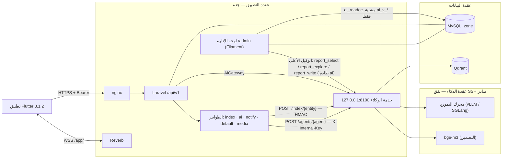

# الأطراف الثلاثة وكيف تترابط

الباك إند (Laravel) هو المركز الوحيد. التطبيق لا يكلّم الذكاء، والذكاء لا يقرأ القاعدة. لوحة الإدارة جزء من الباك إند نفسه: القاعدة نفسها والأصناف نفسها، فكل إجراء فيها هو الإجراء الذي ينفّذه التطبيق.

## الروابط

| الرابط | الاتجاه والنقل | المصادقة | الكود في الطرفين | عند التعطل |
|---|---|---|---|---|
| التطبيق ← الواجهة | HTTPS JSON على `/api/v1` | Sanctum Bearer (90 يوماً) | `routes/api.php` · `app/Http/Controllers/Api/V1` ↔ طبقة الخدمات في التطبيق | رمز خطأ ثابت و`trace_id` (`docs/api.md`) |
| الزمن الحي | WSS عبر nginx `/app/` إلى Reverb | `POST /api/v1/broadcasting/auth` | `routes/channels.php` · `app/Events/MessageSent.php` | الرسائل تبقى في `GET /conversations/{id}/messages` |
| Push | Laravel ← FCM ← الجوال | حساب خدمة Firebase | `app/Notifications/PushChannel.php` · `app/Integrations/Push` | جرس التطبيق (`notifications`) يبقى |
| الذكاء: الوكلاء | Laravel ← `POST /agents/{agent}`، مهلة 20 ث وإعادة سريعة واحدة | `X-Internal-Key` + `X-Request-Id` | `app/Ai/AiGateway.php` ← `AgentsClient.php` ↔ `agents/zon_agents/main.py` · `pipelines/` | ترتيب SQL (`meta.ai.status = fallback`) ولا خصم |
| الذكاء: الفهرسة | Laravel ← `POST /index/{entity}` من طابور `index` | HMAC (`X-Timestamp` · `X-Signature`) بمفتاح `INDEX_SHARED_SECRET` | `app/Indexing/IndexSync.php` ← `app/Jobs/PushIndexEvent.php` ↔ `agents/zon_agents/indexing.py` | الإشارة تبقى في `index_events` وتُعاد كل 15 دقيقة |
| الوكيل الأعلى | اللوحة ← مهمة `RunExecReport` (طابور `ai`) ← `report_select` أو `report_explore` ← SQL معتمد على `ai_v_*` ← `report_write` | المدير العام وحده | `app/SuperAgent` ↔ `agents/zon_agents/pipelines/reports.py` | الصفوف تُحفظ، والتحليل يُسقط إن ذكر رقماً ليس في الصفوف، والتقرير العالق يُعرض متعذراً بعد 6 دقائق |

العقد التفصيلي بين Laravel والوكلاء: `docs/contracts/agents-api.md`. فحص الحمولات الفعلية: `docs/operations.md` ← «عقد Laravel ↔ الوكلاء».

## المسار الذهبي لطلب ذكاء

مثال: `POST /api/v1/ai/matching`. المسار واحد لكل الوكلاء، وما يتغير بينهم هو المرشّحون والتحقق من الجواب.

1. **البوابات** (middleware بالترتيب):
   - الرمز المميّز.
   - الحساب فعّال.
   - الدور يملك الخدمة.
   - الرغبة موجودة.
   - عدّاد المحاولات: 3 أضعاف الحد اليومي، مجابة أو لا، كي لا يصير الجواب الفاشل (المجاني) باباً لنداءات بلا نهاية.
   - حجز محاولة من الحصة اليومية في عملية ذرّية واحدة (Lua على Redis) بطبقات ثلاث: الحساب ×1 · الجهاز ×1.5 · العنوان ×3.
2. **المرشّحون من SQL أولاً** (`app/Ai/Retrieval`): الخانات الإجبارية تضيّق الفضاء قبل أي ذكاء، وحدّه 300 مرشح.
3. **AiGateway:**
   1. إخفاء كل نص (`AiMasking`): الأرقام، البريد، الروابط، الآيبان، والأسماء المعروفة (ومنها اسم صاحب الحساب نفسه في الشات والبحث والمطابقة، وفي ما يُحفظ منها: سؤال لم يجد نتيجة، وعيّنة تدريب).
   2. تجزئة المدخل، والذاكرة المؤقتة 15 دقيقة.
   3. النداء.
   4. تحقق المتصل من الجواب.
   5. الخصم من الحصة عند النجاح الكامل فقط.
   6. سطر في `ai_requests`.
4. **الوكيل:** يرتّب المرشّحين المعطَين ويعطي كل واحد درجة، بلا نص. لا يضيف عنصراً من عنده: `AiGateway::ranked` يُسقط أي معرّف لم يُرسل، ولا يأخذ من النتيجة إلا المعرّف والدرجة.
5. **الرد:** القائمة من MySQL (لا من حمولة الفهرس)، و`meta.ai` يقول ما حدث.

## من يملك الحقيقة

| المعلومة | مصدرها الوحيد | ما يراه الآخرون |
|---|---|---|
| الحسابات، العروض، الطلبات، الأسعار، الحالات | MySQL عبر Laravel | التطبيق يعرض ما تعيده الواجهة؛ Qdrant يحمل نسخة للفلترة فقط |
| الأسعار والأرصدة والحدود التجارية | `packages` و«إعدادات المنصة» | التطبيق لا يحسب سعراً؛ `checkout` يسعّر |
| حالة الدفع | قراءة المزوّد من الخادم | لا يُصدَّق التطبيق ولا محتوى الإشعار |
| فهرس البحث الدلالي | `index_events` (صندوق صادر بإصدارات) | Qdrant يتجاهل إشارة أقدم من المفهرسة |
| نصوص الموجّهات ونسخها | `agents/zon_agents/prompts/*.md` | `ai_requests` يسجل النداء، وسجل الوكلاء يسجل نسخة الموجّه |

## ما تتحكم به اللوحة في التطبيق دون نشر نسخة

| في اللوحة | أثره في التطبيق |
|---|---|
| «إصدار التطبيق والصيانة» (`app_configs`) | التحديث الإجباري (426) والصيانة (503) لكل منصة؛ حسابات الاختبار تعبر الصيانة |
| «الباقات» | الأسعار، الأرصدة، حدود العروض والمخزون والرغبات، سقوف الذكاء اليومية، الميزات |
| «إعدادات المنصة» | كل قيمة تجارية وتشغيلية (الجدول أدناه) |
| «المدن والأحياء» · «المصطلحات والمرادفات» | قوائم الاختيار في التطبيق (`/catalog`) وتوسيع البحث |
| «مكتبة المعرفة» | إجابات شات زون؛ الحفظ يرسلها للفهرس فوراً |
| «صفحات السياسات» | `/legal/{slug}` برقم نسخة جديد مع كل حفظ |
| «الإشعارات العامة» | إشعار لكل المستخدمين أو لدور أو لمدينة |
| الحسابات والمحتوى والإشراف | الإيقاف (يُخرج من كل الأجهزة)، تفعيل المطوّر بعقد التسويق، منح باقة، إخفاء وإرجاع، البلاغات، الاسترداد |

### إعدادات المنصة (`App\Support\Settings\Setting`)

| القسم | الإعداد | الافتراضي |
|---|---|---|
| العروض والإشراف | تذكير المعلن بمراجعة الصياغة بعد (ساعة) | 24 |
| | النشر بالنص الأصلي إن لم يقرر المعلن بعد (ساعة) | 72 |
| | يصير عرض الوسيط غير نشط بلا تحديث بعد (يوم) | 14 |
| | أقصى عدد للصور في العرض | 12 |
| | التحقق عبر نفاذ شرط للنشر | نعم |
| | عدد المبلّغين المختلفين للإخفاء الآلي | 3 |
| التمييز والطلبات | مدة التمييز والعاجل للعرض (يوم) | 7 |
| | سعر التمييز بعد نفاد الرصيد | 100 ريال |
| | سعر «عاجل» للعرض بعد نفاد الرصيد | 100 ريال |
| | سعر الطلب العاجل | 50 ريالاً |
| | مدة بقاء الطلب عاجلاً (يوم) | 7 |
| المالك والعمولات | رسوم الترخيص الإعلاني للمالك (تمرير للهيئة بلا ضريبة) | 50 ريالاً |
| | سعي المالك بعد البيع (٪ من سعر البيع) | 0.5 |
| | حصة زون من سعي الوسيط بلا اشتراك (٪) | 10 |
| الضريبة والفواتير | المنصة مسجّلة في ضريبة القيمة المضافة | لا |
| | نسبة الضريبة | 15٪ |
| | الرقم الضريبي · اسم البائع في الفاتورة | — · منصة زون العقارية |
| الرغبات والحسابات | تتوقف إشعارات الرغبة بلا تحديث بعد (يوم) | 90 |
| | أقصى عدد عروض في إشعار المطابقة الواحد | 5 |
| | مهلة حذف الحساب (يوم) | 30 |
| الذكاء والتقارير | أقصى طول لرسالة الشات (حرف) | 500 |
| | كلمات المنع في الشات | — |
| | الحد الأدنى للطلبات في تقرير السوق (لا يُخفض تحت 5) | 5 |
| | سقف تقارير الوكيل الأعلى اليومي | 30 |

كل تغيير يُسجَّل في سجل التدقيق بقيمته القديمة والجديدة.
